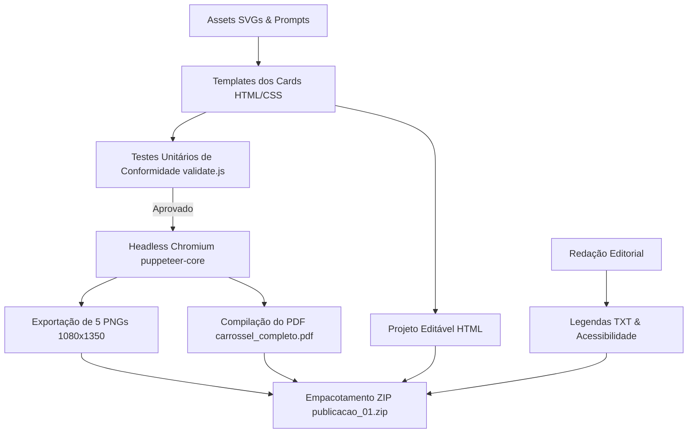

# Arquitetura e Guia de Manutenção — Brincando com os Sons

## 1. Visão Geral e Arquitetura

O projeto foi construído para produzir publicações digitais carrossel (Instagram e Facebook) de padrão visual editorial com renderização programática vetorial em alta definição (1080 × 1350 px, proporção 4:5).

### Componentes da Arquitetura:
- **Camada de Apresentação e Estilo (`/src`, `/assets`):** Modelagem semântica em HTML5, CSS3 moderno (paleta controlada e tipografia Fredoka/Nunito) e ilustrações vetoriais orgânicas com estética de aquarela infantil digital.
- **Camada de Automação e Renderização (`/scripts/render_cards.js`):** Script Node.js que orquestra o Chromium (Microsoft Edge headless via `puppeteer-core`), capturando imagens pixel-perfect sem depender de conversores raster externos de baixa qualidade.
- **Camada de Garantia de Qualidade (`/scripts/validate.js`):** Suite de testes unitários que valida a integridade de todas as frases obrigatórias, proporções 4:5, ausência de termos diagnósticos proibidos e restrições éticas de comunicação infantil.
- **Camada de Entrega (`/Brincando_com_os_Sons/Publicacao_01/`):** Diretório final autocontido com os 5 cards individuais em PNG, textos de legendas específicos para cada rede social, documento de acessibilidade WCAG/leitor de tela, PDF unificado e pacote ZIP.

---

## 2. Fluxo de Dados



1. **Definição dos Estímulos:** As ilustrações (pato, panela, pipa, pão) e elementos gráficos são definidos em `/assets/svgs.js` com paleta de cores estrita.
2. **Composição dos Cards:** `src/templates/cards.js` monta a estrutura de cada card com hierarquia visual, espaçamento de segurança e tipografia responsiva.
3. **Validação:** `scripts/validate.js` executa verificações assíncronas para garantir conformidade antes de qualquer renderização em disco.
4. **Renderização e Exportação:** `scripts/render_cards.js` inicializa a sessão headless, define o viewport 1080×1350, captura cada card, gera o PDF multipáginas e empacota o arquivo ZIP final.

---

## 3. Como Manter e Criar Novos Episódios

Para criar o próximo episódio (ex: Episódio 02 — O som /m/):

1. **Adicionar novos Assets em `/assets/svgs.js`:**
   - Crie as ilustrações com paleta harmônica e traços amigáveis (ex: macaco, maçã, melancia, meia).
2. **Documentar os Prompts em `/prompts/`:**
   - Registre os prompts no formato padrão: `[Tema]`, `[Ângulo de Câmera]`, `[Iluminação]`, `[Lente/Equipamento]`.
3. **Duplicar ou parametrizar o gerador de templates em `/src/templates/`:**
   - Atualize as palavras-chave no Card 02 e Card 03, garantindo o destaque da letra inicial na cor coral (`#F47752`).
4. **Atualizar testes unitários em `/scripts/validate.js`:**
   - Inclua os novos termos esperados na suite de validação.
5. **Executar a suíte de build:**
   ```bash
   npm test
   node scripts/render_cards.js
   ```
6. **Verificar a pasta de saída:**
   - Os arquivos do novo episódio estarão organizados e prontos para publicação em `Brincando_com_os_Sons/Publicacao_XX/`.
